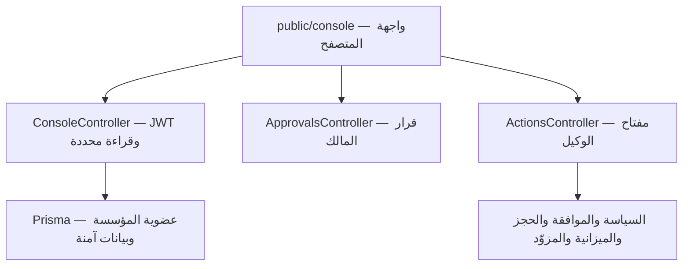

# لوحة AgentGate

واجهة عربية متجاوبة بهوية الخلية وألوان العسل والفحمي. تعمل من نفس سيرفر
AgentGate وتعرض بيانات قاعدة بياناتك الفعلية، بدون أرقام أو موافقات تجريبية
مصطنعة في الشاشة. لا تحتاج خادم frontend منفصلًا أو إعداد CORS.

## التشغيل على Windows

استخدم Node 24.19.0، ثم من نافذة CMD الخاصة ببيئة التطوير:

```cmd
cd /d C:\projects\agentgate
git pull --ff-only
npm ci
set "DATABASE_URL="
npm run prisma:generate
npm run build
npm start
```

فتح `http://127.0.0.1:3000/console` يعرض شاشة الدخول. المسار `/` يحوّل إليها.
السطر الذي يمسح DATABASE_URL يزيل override نافذة CMD ليعود التطبيق لقراءة
قاعدة التطوير من `.env`. لا تستخدم نافذة مضبوطة على قاعدة اختباراتك لتجربة المنتج.
لا توجد migration جديدة لهذه الواجهة؛ قاعدة البيانات تحتاج migrations المشروع السابقة.

لو Argon2 اتمنع من التحميل بعد `npm ci`، راجع خطوات البناء المحلي في
[دليل الاعتماديات](dependency-maintenance.md)، بدون تعطيل سياسات حماية Windows.

## الشاشات والرحلة

1. **الحساب والمؤسسة:** سجل الدخول بحسابك الحالي أو أنشئ حسابًا. المؤسسات
   المعروضة مستخرجة من عضوياتك المحفوظة. إنشاء مؤسسة يجعلك OWNER لها.
2. **نظرة عامة:** أعداد الوكلاء والتنفيذات والموافقات المفتوحة والنتائج غير
   المؤكدة لجميع الأوقات، مع أحدث ثمانية تنفيذات. بيانات اتصال فعلية من readiness.
3. **الوكلاء والمفاتيح:** قائمة ذات صفحات، إنشاء وكيل، وإصدار مفتاح للمالك.
   المفتاح يظهر مرة واحدة ويمكن نسخه أو ربطه بالمعمل. الإصدار لا يلغي مفتاحًا قديمًا.
4. **الموافقات:** اعرض الطلب المحفوظ كمالك، راجعه، ثم وافق أو ارفض. القرار
   لا ينفّذ الفعل تلقائيًا. MEMBER يرى ملخصًا بدون الطلب الحساس ولا يستطيع القرار.
5. **التنفيذات:** تصفية بالحالة وصفحات cursor، تفاصيل السياسة والمحاولات.
   OWNER يرى arguments/result؛ MEMBER يرى ملخصًا. تفاصيل الفعل لا تُرسل للعضو
   من السيرفر أصلًا، وليست مجرد عناصر مخفية في الصفحة.
6. **الميزانية:** اختر اليوم UTC والبيئة. اعرض المستهلك والمحجوز والمتاح.
   عدم وجود bucket يعرض رسالة صريحة، وليس رصيدًا صفريًا أو غير محدود.
7. **المراقبة والمحاكاة:** اعرض الدراسات غير المنتهية، أو حاكي قواعد على
   معرّفات تنفيذات داخل مؤسستك كمالك. النتيجة لا تعدّل سياسة السيرفر ولا تمنح إذن تنفيذ.
8. **جرّب فعلًا:** اربط مفتاح وكيل تابع للمؤسسة المحددة، اختر paymentId ومبلغًا
   بالدولار (يحوَّل إلى سنتات صحيحة)، ثم راقب فقط أو أرسل طلب استرداد وهمي.

صفحة «دليل البداية» تولّد أوامر إعداد الدفعة والسياسة بمعرّف المؤسسة الحالية.
تجهيز FakePayment والسياسات والميزانيات يتم من الأدوات وإعدادات السيرفر الموجودة؛
لا تستطيع الواجهة تغييرها أو تفعيل المعمل من تلقاء نفسها. الافتراضي للسياسة DENY.

## الجلسات والأفعال

- JWT ومفتاح الوكيل في ذاكرة الصفحة فقط. لا cookies للجلسة ولا localStorage أو
  sessionStorage للأسرار. إعادة تحميل الصفحة أو الخروج تتطلب تسجيل دخول جديد.
- عند انتهاء جلسة المستخدم تمسح الواجهة المفتاح وبيانات الجلسة. تسجيل الخروج
  هنا يمسح نسخة المتصفح؛ لا يُبطل JWT أو API key على السيرفر.
- تغيير المؤسسة يمسح مفتاح الوكيل ونتائج العرض السابقة. الردود المتأخرة من
  المؤسسة السابقة لا تُعرض في المؤسسة الجديدة.
- `GET /v1/console-agent/identity` يتحقق من المفتاح عبر AgentAuthGuard ويرجع
  organizationId وagentId فقط. ربط مفتاح مؤسسة مختلفة مرفوض في الواجهة.
- قبل الإرسال يثبت الطلب ومفتاح منع التكرار وهوية الوكيل. انقطاع الشبكة لا
  يبدّل المفتاح ولا يسبب إعادة تلقائية. إعادة الإرسال تستخدم نفس البيانات والمفتاح.
- احفظ معرّف التنفيذ ومفتاح الطلب قبل إغلاق الصفحة، خصوصًا عند انقطاع الرد؛
  النسخة الموجودة بالذاكرة لا تنجو من إعادة التحميل. لا تستخدم طلبًا جديدًا لحل نتيجة مجهولة.
- الاستكمال وإعادة المحاولة يحتاجان مفتاح نفس الوكيل، ويمران على الـ API الحالي.
  المالك يستطيع reconciliation بهويته البشرية عبر المسار الموجود، بدون صلاحية retry إضافية.
- لا تعني رؤية زر أن الفعل مسموح: الباك إند يعيد فحص المصادقة والهوية والسياسة
  والموافقة والحجز والميزانية في مسار التنفيذ الأصلي.

## الربط المعماري



`src/console/` يضيف عرضًا للبيانات فقط، ولا يكرر منطق تنفيذ الأفعال. ملفات
المتصفح JavaScript modules وCSS ثابتة بدون خطوة bundling أو CDN أو مكتبات تشغيل
واجهة إضافية. ملف `model.mjs` يحتوي تحويل المبالغ وإخفاء markup وتثبيت الطلب.

المسارات الجديدة تحت `/v1/console` تحتاج JWT:

- `/workspaces`: أول 100 عضوية، مع `hasMore` لو تجاوز العدد ذلك.
- `/:organizationId/overview`: إحصاءات محددة بدون arguments أو result.
- `/:organizationId/executions`: صفحات من 25 سجلًا مع cursor وحالة اختيارية.
- `/:organizationId/executions/:id`: تفاصيل محددة بحسب دور العضو.

المحتوى العام في `/console` ليس سريًا؛ الـ API يظل محميًا. ملفات الواجهة فقط
مسموح بخدمتها عبر قائمة ثابتة، بدون wildcard يفتح ملفات المشروع. CSP يمنع
inline scripts والـ framing والاتصال بأصول أخرى. جميع القيم الديناميكية المعروضة
كـ HTML تُهرب، وJSON يعرض كنص. Docker ينسخ `public/` مع الملفات المبنية.

## الاختبارات والحدود

`npm test` يشمل اختبارات DOM بـ jsdom لتسجيل الدخول، فصل هوية الوكيل، منع
ربط مفتاح مؤسسة أخرى، إعادة نفس الطلب بعد فقدان الرد، اتخاذ القرار بدون dispatch،
وإهمال الردود المتأخرة بعد تغيير المؤسسة. توجد اختبارات لتحويل الدولار وهروب
HTML وتثبيت intent، وخدمة الأصول وCSP وحماية مسارات العرض.

اختبار `test/console-monitoring.integration.cjs` يحتاج قاعدة `agentgate_test`؛
يفحص العزل والـ pagination وحجب الحقول الحساسة عن MEMBER وعدم حدوث أثر من القراءة.

لا تُساوي اختبارات DOM اختبار عرض بصري في متصفح حقيقي. لم يتوفر مسار معاينة
المتصفح المدعوم في بيئة التنفيذ لهذه المهمة؛ المقاسات والتفاعل البصري يحتاجان
مراجعة في متصفح المستخدم. لم تُنشر خدمة عامة أو قاعدة بيانات للإنترنت.

هذه لوحة للنسخة التجريبية الحالية، وليست إدارة إنتاجية كاملة. لا توجد هنا
شاشات لتغيير السياسات والميزانيات، إدارة الأعضاء، إلغاء المفاتيح، إيقاف الوكلاء،
استعادة كلمة المرور أو مزوّد أموال حقيقي. السلوك الأساسي وإصدارات migrations محفوظة.

نقطة استئناف الشرح: رحلة التشغيل، ثم `validateEnvironment` وربط `ConfigModule`
بـ `AppModule`، وبعدها رحلة قاعدة البيانات و`/health/ready`.
