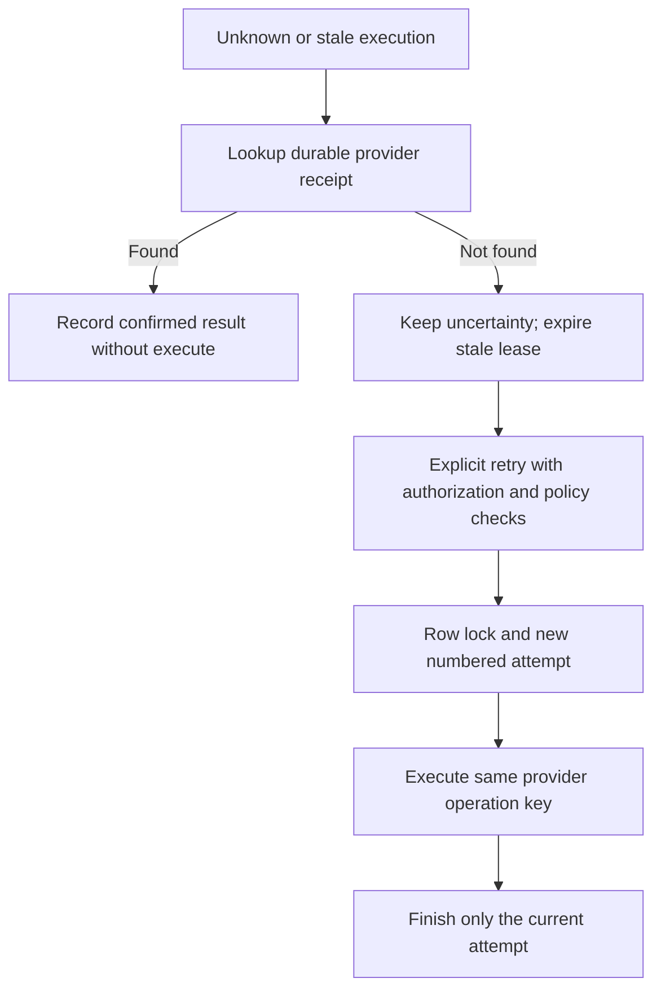

# Phase E — safe recovery in the Fake Commerce lab

Implemented contract: explicit reconciliation and bounded, fenced retries for new
executions using the durable fake-provider idempotency contract. No real external
provider, background scheduler, arbitrary FAILED retry, approval expiry, or budget
engine is introduced. This is not a general external exactly-once guarantee.

## Before / after

Before: one attempt, ambiguous results replayed forever, no provider receipt.
After: up to three numbered dispatch attempts; one active attempt; a 30-second
lease; 2/4-second backoff after unknown dispatch results; expired lease observation
uses a conservative 8-second backoff. These deadlines are returned in the API.
No POST replay or ordinary resume silently retries an unknown operation.



## New routes

All bodies must be absent or `{}`. No replacement action payload is accepted.

- Agent Bearer key: `POST /v1/executions/:id/reconcile`
- Agent Bearer key: `POST /v1/executions/:id/retry`
- OWNER JWT: `POST /v1/organizations/:organizationId/executions/:id/reconcile`

Agent routes require the same authenticated organization AND original agent.
The OWNER route checks stored membership and permits observation after suspension
or key revocation; it never dispatches or bypasses a policy to retry.
There is no OWNER retry endpoint. Existing suspension/revocation administration
endpoints remain deferred; the persisted flags are enforced at authentication and claim.

Reconciliation does not require current ALLOW: recording a previously committed
result is not permission to create another effect. It verifies stored request
binding and environment. FOUND confirms the operation. NOT_FOUND never proves
absence of a late/in-flight effect. Expired EXECUTING may become OUTCOME_UNKNOWN;
active leases remain EXECUTING. Lookup failures propagate; no dispatch follows.

Retry first looks up the receipt. A known result is reconciled even after the
attempt budget is exhausted. Otherwise the new dispatch requires:

1. New execution `recoveryVersion = 1`, and a provider declaring that contract.
2. UNKNOWN or expired EXECUTING, elapsed backoff, fewer than three attempts.
3. Complete original policy evidence; original approval if required, exact hashes,
   supported current action definition and the same environment.
4. Current policy allows dispatch (or requires an already valid approval).
5. Active agent and non-revoked credential checked in the conditional claim.

A current policy denial blocks the retry without rewriting UNKNOWN as DENIED:
we cannot claim a prior effect did not happen. Terminal FAILED/SUCCEEDED replay
unchanged. Policy-tightened DENIED remains blocked. Historical version-0 records
are NOT upgraded; they require manual investigation. A migration does not invent
receipts for earlier effects.

## Storage and concurrency

`ExecutionAttempt.executionId` is no longer unique alone. The pair
`(executionId, attemptNumber)` is unique, plus a partial unique index permits only
one EXECUTING attempt. Existing attempts are backfilled as attempt 1. Attempt
identity and closed observation are immutable; subsequent evidence is stored in
`resolvedAt`/`resolvedStatus`, preserving the original unknown observation.

`claimRetry` locks the tenant/agent-scoped execution row with `FOR UPDATE`, checks
the observed attempt count and all guards, closes an expired attempt as UNKNOWN,
and creates the next attempt in one transaction. Concurrent callers cannot both
win. `finish` matches the current attempt number and updates the exact attempt ID.
A late older worker receives 409 and cannot overwrite newer progress. A lease is
not evidence of provider cancellation; an old worker may still arrive there.

`FakeProviderReceipt` is keyed by the stable execution ID, scoped to organization
and request hash. The receipt placeholder, fake payment effect, and final outcome
commit in ONE provider transaction. Duplicate inserts serialize on the unique
key. Both successes and definitive failures are persisted and replayed; the
receipt survives removal of the fake payment. A lost response is simulated AFTER
this commit. Receipt binding and completed outcomes cannot be updated.
The lab receipt is cascade-deleted when test execution fixtures are deleted; a
real provider needs an explicit idempotency retention contract and audit retention.

Dispatch uses the SAME execution ID across attempts, not the attempt ID or a new
client key. Therefore even a late original worker racing a retry gets the same
provider result. This guarantee comes from the fake provider's atomic receipt,
not from interpreting NOT_FOUND or from a database transaction spanning the network.
Do not swap in an external provider unless equivalent idempotency and lookup
semantics are verified. Application clocks should be synchronized; lease timing
is an operational bound, while provider deduplication protects effects even if a
lease expires while an old worker remains alive.

## Windows update and verification

In the development CMD (keep local changes; do not use reset --hard):

```cmd
git pull --ff-only
set "DATABASE_URL="
npx prisma migrate deploy
npm run prisma:generate
npm test
npm run lint
```

In a separate test CMD, set TEST_DATABASE_URL to the dedicated `agentgate_test`
connection and set DATABASE_URL to the same URL, then apply migrations and run:

```cmd
node --test --test-concurrency=1 test/execution-recovery.integration.cjs test/recovery-concurrency.integration.cjs
```

Use normal development DATABASE_URL when starting the API. Do not run fixture
cleanup against the development or production database. Windows native argon2
may need the previously installed Build Tools and `npm rebuild argon2 --build-from-source`
if dependencies were reinstalled; no package changes are required by this phase.

## Postman exercise

Import `AgentGate-Phase-E.postman_collection.json`. Configure baseUrl, agentApiKey,
organizationId and ownerAccessToken locally; never export populated secrets.
Seed a NEW payment under that organization (example `payment_recovery_01`, 10000
cents). Use an ALLOW policy for a 1000-cent refund.

1. Start API with `FAKE_COMMERCE_SCENARIO=unknown` and existing development flags.
2. Submit once with `Idempotency-Key: recovery-01`: UNKNOWN, attempt 1.
3. Reconcile: SUCCEEDED from receipt, still one attempt, no second refund.
4. For a separate payment/key, start with scenario `timeout` and submit: UNKNOWN.
5. Reconcile reports NOT_FOUND; this does NOT authorize a retry by itself.
6. Restart with scenario `success`, wait until nextRetryAt, call retry: attempt 2
   succeeds using the same execution/provider key. Repeating retry replays it.

## شرح مختصر للكود

- `retryWindow`: شروط التوقيت والعقد وعدد المحاولات، وليس تصريحًا مستقلًا للتنفيذ.
- `ActionProvider`: عقد المزوّد؛ lookup للاستعلام، execute يلتزم بنفس مفتاح العملية.
- `claimRetry`: قفل صف التنفيذ، فحص الشروط، ثم إنشاء محاولة جديدة ذريًا.
- `finish(..., attemptId)`: رد العامل القديم لا يكتب فوق المحاولة الحالية.
- `reconcile`: يحفظ الدليل المؤكد، ولا يستدعي execute.
- `FakeProviderReceipt`: لو الاسترداد حصل والرد ضاع، النتيجة تظل محفوظة.

مثال: التنفيذ X ومحاولته 1 انتهيا برد مجهول بعد استرداد 10 دولارات. lookup(X)
يرجع النجاح المحفوظ؛ نسجّل SUCCEEDED ونضيف دليل الحسم للمحاولة القديمة. لو لا يوجد
سجل، لا نخمن؛ retry مصرح بها فقط تحت عقد المزوّد، وبنفس X، حتى لو المحاولة أصبحت 2.

## Known limits

No automatic sweeper/queue; callers/operators explicitly reconcile stale rows.
No real provider and no universal exactly-once claim. Three attempts maximum;
FAILED business rejections are terminal. No expiry/cancellation of approvals in
this slice. Policies remain a consistent startup snapshot across instances.
Observation cannot retroactively cancel an effect. MEMBER sees no new recovery
powers. Tenant and owner checks do not replace operational database permissions.
