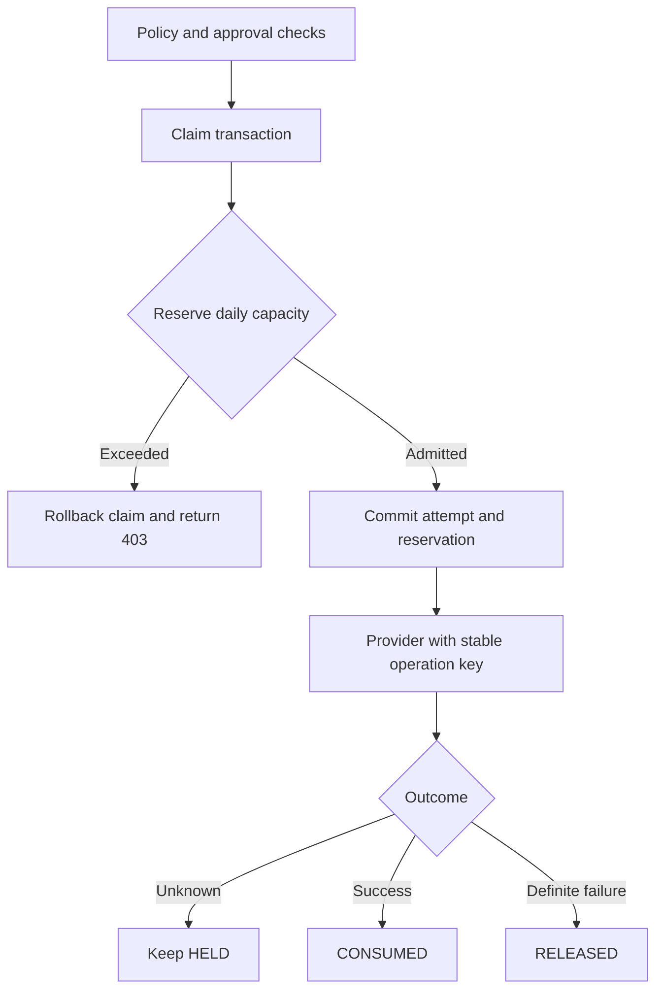

> Update: a changed configuration now leaves today’s recorded cap in force instead of blocking all new reservations. The new cap applies to the next newly opened UTC-day bucket. See [operational hardening](operational-hardening.md#mid-day-budget-changes).

# Phase F — Daily refund budget

Implemented slice: one server-configured USD refund budget per organization and
execution environment, shared by all its agents. Velocity limits, generic counters,
kill/freeze administration, simulation and MCP are not part of this slice.

## Contract

A bucket is identified by `(organizationId, environment, currency, UTC day)`.
The day is the **first dispatch admission day**, not the request receipt day or
provider settlement day. Money is integer minor units: USD 10000 = $100.

`availableMinor = limitMinor - reservedMinor - consumedMinor`

- Reserve inside the same transaction as the initial execution claim and attempt.
- A conditional SQL update admits a request only if reserved + consumed + amount
  fits the cap. Different agents/executions compete on the same bucket row.
- At most one immutable reservation per execution. Retry reuses it, including
  across midnight. It is not charged again or moved to a new day.
- SUCCEEDED moves HELD to CONSUMED. Definite FAILED moves HELD to RELEASED.
- OUTCOME_UNKNOWN, lease expiration and provider NOT_FOUND never release funds.
- Worker finish and reconciliation settle under the existing execution lock in
  the same transaction as the final outcome. A stale worker cannot release funds.
- PENDING/APPROVED approval alone reserves nothing; resume must pass the budget.
- A budget rejection is a transient capacity rejection: HTTP 403,
  `DAILY_REFUND_BUDGET_EXCEEDED`, executionId; the execution remains RECEIVED with
  no attempt/provider call. Replaying the same exact request may succeed after
  a confirmed failure frees capacity or on another UTC day. It is **not** an
  initial policy decision and does not overwrite frozen policy evidence.
- There is no automatic replay, midnight job or scheduler.

## Configuration and rollout

Put a single JSON line in `.env`, then restart every application instance:

```dotenv
REFUND_BUDGETS_JSON='[{"organizationId":"1832bd19-038d-49b8-895e-c45a71a9c606","environment":"development","currency":"USD","limitMinor":10000}]'
```

This is an explicit opt-in business constraint. Default `[]` adds no new budgets;
existing policy and approval gates still apply. Unsupported currency, malformed
JSON, duplicate scopes, negative/non-integer amounts and unknown properties fail
startup without echoing configuration contents. Zero is a valid cap and blocks all
positive refunds. Maximum configured cap is 2147483647 minor units.

Every node must run this version with the same configuration snapshot; do not use
a mixed old/new deployment when enabling enforcement. Configure all intended
organization/environment scopes explicitly. Development and staging do not share
capacity.

The first successful reservation opens the day's bucket and freezes its cap.
Changing the configured amount mid-day keeps today’s recorded cap active;
restore the original amount or deploy the new amount for the next UTC day.
Removing the config does not bypass a bucket already opened today; future days
without a rule have no budget. This is operator configuration, not a client override.

Activation does not invent a historical balance. The first bucket refuses
unbudgeted successful refunds dispatched today or unresolved unbudgeted refunds
from any day (`BUDGET_BASELINE_REQUIRES_REVIEW`). Start with a clean demo organization,
or resolve ambiguous old work and enable on a later UTC day. Do not alter historical
records to get around this check. Retrying an already-started unbudgeted operation
under an active budget returns `BUDGET_RESERVATION_MISSING`; observing its result is
still possible through Phase E reconciliation.

A cap applies to the admission day. Delayed effects/retries may settle later while
remaining charged to that original bucket. This is not a cap on settlement-date
cashflow, not a rolling 24-hour limit and not a total cross-day exposure limit.

## Monitoring

```http
GET /v1/organizations/:organizationId/refund-budgets?environment=development&day=2026-10-15
Authorization: Bearer <user JWT>
```

Both OWNER and MEMBER may read aggregate amounts; outsiders receive 404. No action
arguments, credentials or customer data are included. The default day is today's
UTC day and default environment is development. A missing bucket returns 404
(which does not prove no rule is configured: no successful reservation may have
opened it yet). The endpoint does not edit limits.

GET execution responses now include `refundBudgetReservation` (or null), with day,
currency, amountMinor, status and settledAt.

## Implementation map



- `src/budgets/refund-budget-config.ts`: strict server configuration and UTC day.
- `src/budgets/refund-budget-ledger.ts`: reservation, atomic admission and settlement.
- `src/executions/executions.service.ts`: integration with claim/retry/finish/reconcile.
- `src/budgets/refund-budgets.controller.ts`: membership-scoped aggregate monitoring.
- `prisma/migrations/20261014193000_daily_refund_budget/migration.sql`: unique
  scopes/reservations, tenant foreign keys, counter checks and immutable binding.

No new library or infrastructure service is required. SQL row updates provide the
shared coordination across processes; an in-memory counter cannot provide this.
Database-owner maintenance can still delete records: production retention and
privileged DB access require operational controls. Do not prune the ledger while
its evidence is needed.

## Windows update and verification

```bat
cd /d C:\projects\agentgate
git pull --ff-only
set "DATABASE_URL="
npx prisma migrate deploy
npm run prisma:generate
npm test
npm run lint
```

If Git reports local changes, preserve/review them; do not reset the working tree.

In a separate CMD window, set TEST_DATABASE_URL to your dedicated agentgate_test
connection, then:

```bat
set "DATABASE_URL=%TEST_DATABASE_URL%"
npx prisma migrate deploy
node --test --test-concurrency=1 test/refund-budget.integration.cjs test/refund-budget-concurrency.integration.cjs test/execution-recovery.integration.cjs test/recovery-concurrency.integration.cjs
```

Integration tests guard the database name. `npm test` does not run these files.
The GitHub backend workflow runs the complete database suite on PostgreSQL 17.

## Manual example (after E/F teaching)

Use a clean demo organization with an ALLOW policy for USD refunds and a daily cap
of 10000. Seed **two different payments**, so business duplicate prevention does
not hide the budget scenario:

```bat
node scripts/seed-fake-payment.mjs YOUR_ORGANIZATION_UUID budget_payment_a 100000
node scripts/seed-fake-payment.mjs YOUR_ORGANIZATION_UUID budget_payment_b 100000
```

Import `docs/AgentGate-Phase-F.postman_collection.json`. Set baseUrl, organizationId,
agentApiKey, accessToken and a fresh runId. Request A refunds 6000; request B refunds
5000 and receives budget exceeded; request C refunds 4000 from payment B and fills
the cap exactly. They use distinct idempotency keys. Monitoring reports consumed
10000, reserved 0, available 0. A replay consumes no additional capacity.

For an unknown-outcome example, start with a fresh budget scope/day and use Phase E
lost-response simulation: reserved remains held until reconciliation confirms the
outcome. Changing environment is not a recovery mechanism; keep original request
binding and never invent a second execution to recover an ambiguous effect.

## Teaching notes (Arabic)

هنشرح E وF مع بعض: E بتحافظ على هوية العملية والمحاولة وبتحل النتيجة المجهولة؛
F بتحجز نصيب العملية من الميزانية. نجاحها ينقل الحجز لاستهلاك، والفشل المؤكد
يحرّره. الرد المفقود مش تصريح لتحرير الحجز، وإعادة المحاولة مش عملية مالية جديدة.
